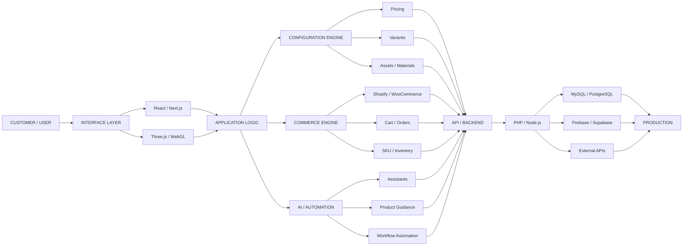

<!--
  ╔══════════════════════════════════════════════════════════════════════╗
  ║                      ENIS GJINI · SYSTEM PROFILE                   ║
  ║         Full-Stack · WebGL · Commerce · SaaS · AI Systems          ║
  ╚══════════════════════════════════════════════════════════════════════╝
-->

<div align="center">


<br />


<br /><br />


<br /><br />

<a href="mailto:hello@enis.dev">
  
</a>
<a href="https://linkedin.com/in/enisgjinii">
  
</a>
<a href="https://enis.dev">
  
</a>

<br /><br />


<br /><br />

<sub>
<a href="#-system-overview">OVERVIEW</a>
&nbsp;•&nbsp;
<a href="#-architecture-map">ARCHITECTURE</a>
&nbsp;•&nbsp;
<a href="#-capability-matrix">CAPABILITIES</a>
&nbsp;•&nbsp;
<a href="#-selected-systems">SYSTEMS</a>
&nbsp;•&nbsp;
<a href="#-technology-core">STACK</a>
&nbsp;•&nbsp;
<a href="#-engineering-protocol">PROTOCOL</a>
&nbsp;•&nbsp;
<a href="#-github-telemetry">TELEMETRY</a>
&nbsp;•&nbsp;
<a href="#-initialize-a-project">CONTACT</a>
</sub>

</div>

<br />

---

# ⚡ System Overview

```txt
┌──────────────────────────────────────────────────────────────────────┐
│  ENGINEER        ENIS GJINI                                         │
│  PRIMARY ROLE    FULL-STACK DEVELOPER                               │
│  SPECIALTY       3D CONFIGURATORS / WEBGL / PRODUCT SYSTEMS         │
│  FRONTEND        REACT / NEXT.JS / THREE.JS                         │
│  BACKEND         PHP / NODE.JS / MYSQL / API SYSTEMS                │
│  COMMERCE        SHOPIFY / WOOCOMMERCE / HEADLESS                   │
│  AUTOMATION      AI WORKFLOWS / ASSISTANTS / PRODUCT LOGIC          │
│  DELIVERY        REMOTE / ASYNC / PRODUCTION-FIRST                  │
└──────────────────────────────────────────────────────────────────────┘
```

I engineer **high-performance digital products where normal website architecture stops being enough**.

My work lives at the intersection of:

**Product UX × real-time 3D × commerce logic × backend architecture × automation**

I specialize in turning complex business requirements into interfaces and systems that remain understandable, scalable, responsive, and usable in production.

<br />

<table>
<tr>
<td width="25%" align="center">

### `01`

**REAL-TIME 3D**

Three.js
React Three Fiber
WebGL
GLB / GLTF

</td>
<td width="25%" align="center">

### `02`

**COMMERCE**

Shopify
WooCommerce
Headless
Product Logic

</td>
<td width="25%" align="center">

### `03`

**PLATFORMS**

React
Next.js
PHP
Node.js

</td>
<td width="25%" align="center">

### `04`

**INTELLIGENCE**

AI Workflows
Automation
Assistants
Product Logic

</td>
</tr>
</table>

<br />

---

# 🧬 Architecture Map

<div align="center">

### `One product. Multiple engineering layers. One coherent system.`

</div>



<br />

> **The interface is only the visible layer.**
> The real engineering starts when configuration logic, commerce rules, assets, pricing, APIs, state, performance, exports, and business operations must all behave like one product.

<br />

---

# 🛰 Capability Matrix

| SYSTEM                       | ENGINEERING SCOPE                                                                     | OUTPUT                       |
| :--------------------------- | :------------------------------------------------------------------------------------ | :--------------------------- |
| **3D Product Configurators** | WebGL scenes, configuration state, materials, options, assets, uploads, dynamic rules | Interactive product builders |
| **Shopify Systems**          | Storefront API, Liquid, GraphQL, product logic, SKU logic, custom workflows           | Commerce infrastructure      |
| **SaaS Platforms**           | Dashboards, authentication, APIs, payments, admin systems, data workflows             | Production web applications  |
| **AI Product Workflows**     | Assistants, recommendation logic, extraction, semantic workflows, automation          | Intelligent product features |
| **Backend Systems**          | PHP, Node.js, REST/GraphQL, databases, external services                              | Reliable application logic   |
| **Frontend Systems**         | React, Next.js, responsive UX, state architecture, interaction systems                | High-performance interfaces  |

<br />

<div align="center">


</div>

<br />

---

# 🧊 3D Commerce Engine

A configurator is not just a model viewer.

The systems I build combine multiple layers:

```txt
PRODUCT
│
├── Geometry
│   ├── GLB / GLTF
│   ├── Mesh hierarchy
│   └── Optimized assets
│
├── Appearance
│   ├── PBR materials
│   ├── Colors
│   ├── Textures
│   └── Product variants
│
├── Configuration
│   ├── Option dependencies
│   ├── Availability rules
│   ├── Dynamic pricing
│   └── Configuration state
│
├── Customer Input
│   ├── Logo uploads
│   ├── Text
│   ├── Images
│   └── Custom options
│
├── Commerce
│   ├── SKU mapping
│   ├── Variant resolution
│   ├── Cart integration
│   └── Order metadata
│
└── Output
    ├── Preview
    ├── PNG
    ├── SVG
    ├── PDF
    └── Production data
```

<div align="center">


</div>

<br />

---

# 🧠 What I Build

<table>
<tr>
<td width="50%" valign="top">

## `01 // 3D_CONFIG`

### 3D Product Configurators

Real-time customization systems for products requiring more than static images and dropdown selectors.

**Core systems**

* real-time WebGL previews
* material and color switching
* configuration dependencies
* dynamic product options
* uploaded artwork
* pricing logic
* variant resolution
* output generation
* commerce integration
* mobile optimization

**Core stack**

```txt
Three.js
React Three Fiber
WebGL
GLB / GLTF
Blender
PBR Materials
React
APIs
```

</td>

<td width="50%" valign="top">

## `02 // COMMERCE`

### Shopify & E-Commerce Engineering

Commerce systems designed around real product operations rather than generic theme behavior.

**Core systems**

* custom storefront functionality
* SKU / variant architecture
* product builders
* headless commerce
* Shopify integrations
* inventory logic
* customer configuration data
* admin workflows
* automation

**Core stack**

```txt
Shopify
Liquid
Storefront API
GraphQL
Hydrogen
JavaScript
Node.js
Custom APIs
```

</td>
</tr>

<tr>
<td width="50%" valign="top">

## `03 // INTELLIGENCE`

### AI-Powered Workflows

Intelligence embedded directly into product and operational workflows.

**Core systems**

* AI assistants
* product guidance
* recommendation logic
* workflow automation
* semantic search
* extraction
* content generation
* internal utilities
* customer-facing AI tools

**Core stack**

```txt
OpenAI
Node.js
LangChain
Prompt Workflows
Semantic Search
APIs
Automation
```

</td>

<td width="50%" valign="top">

## `04 // PLATFORM`

### SaaS & Full-Stack Platforms

Production applications with everything behind the interface handled as part of the product.

**Core systems**

* dashboards
* admin panels
* authentication
* user management
* payments
* API architecture
* file workflows
* databases
* third-party integrations

**Core stack**

```txt
React
Next.js
PHP
Node.js
MySQL
PostgreSQL
Firebase
Supabase
Stripe
```

</td>
</tr>
</table>

<br />

---

# 🧩 Selected Systems

## `CONFIGURE_XK`

**Reusable 3D configuration architecture**

```txt
CATEGORY       3D Configurator Platform
PURPOSE        Product customization infrastructure
ENGINE         React + Three.js + WebGL
CAPABILITIES   Preview / Options / Pricing / Ordering
```

A reusable framework for building product customization experiences without rebuilding the configuration engine from zero for every product.

---

## `SHOPIFY_SKU_ENGINE`

**Commerce product-logic infrastructure**

```txt
CATEGORY       E-Commerce Infrastructure
PLATFORM       Shopify
LOGIC          Garment / Color / Size / SKU / Pricing
INTERFACE      Liquid + JavaScript + APIs
```

Centralizes product and SKU relationships so complex configuration logic remains manageable across the storefront and ordering pipeline.

---

## `3D_APPAREL_CUSTOMIZER`

**Real-time retail visualization**

```txt
CATEGORY       Product Visualization
ENGINE         Three.js
FORMAT         GLB
UI             React
FEATURES       Materials / Logos / Options / Export
```

Interactive apparel customization combining product materials, uploaded artwork, configuration state, preview generation, and order-ready product data.

---

## `AI_PRODUCT_WORKFLOWS`

**Automation integrated into product systems**

```txt
CATEGORY       AI / Automation
ENGINE         OpenAI + Node.js
INTERFACE      API-driven
USE CASES      Guidance / Content / Internal Tools / Automation
```

AI functionality treated as part of the application architecture—not as a disconnected chatbot.

<br />

---

# 🏗 Build Pipeline

```txt
01
DISCOVERY
└── Understand the real business system

        ↓

02
ARCHITECTURE
└── Define data, state, dependencies and interfaces

        ↓

03
PROTOTYPE
└── Validate the difficult interactions early

        ↓

04
ENGINEERING
└── Build production components and services

        ↓

05
INTEGRATION
└── Connect commerce, APIs, data and automation

        ↓

06
OPTIMIZATION
└── Performance, responsive behavior and edge cases

        ↓

07
QA
└── Real-device and real-flow verification

        ↓

08
DEPLOYMENT
└── Production release and handoff
```

<br />

<table>
<tr>
<td width="33%" valign="top">

### `01 / SCOPE`

Before implementation:

* goals
* constraints
* user flows
* product rules
* data model
* integrations
* milestones

</td>

<td width="33%" valign="top">

### `02 / BUILD`

During engineering:

* component structure
* state architecture
* scalable APIs
* responsive behavior
* performance budget
* device testing

</td>

<td width="33%" valign="top">

### `03 / SHIP`

Before release:

* QA
* optimization
* deployment
* documentation
* handoff
* support planning

</td>
</tr>
</table>

<br />

---

# 🧰 Technology Core

<div align="center">

### `FRONTEND // INTERACTION // 3D`

<br />


<br /><br />

```txt
React • Next.js • TypeScript • JavaScript • Tailwind
Three.js • React Three Fiber • WebGL • Responsive UI
```

<br />

### `BACKEND // DATA // SERVICES`

<br />


<br /><br />

```txt
PHP • Node.js • Express • REST • GraphQL
MySQL • PostgreSQL • Firebase • Supabase
```

<br />

### `INFRASTRUCTURE // DELIVERY`

<br />


<br /><br />

```txt
Docker • AWS • Vercel • Git • GitHub
API Integrations • Production Deployment
```

<br />

### `COMMERCE // 3D // AI`

<br />


<br /><br />


</div>

<br />

---

# 🛡 Engineering Protocol

<table>
<tr>
<td width="50%" valign="top">

## `OPTIMIZE_FOR`

```diff
+ Fast initial load
+ Smooth interaction
+ Predictable state
+ Clear data flow
+ Mobile 3D performance
+ Maintainable architecture
+ Production resilience
+ Business-aligned logic
+ Clean handoff
+ Measurable simplicity
```

</td>

<td width="50%" valign="top">

## `REJECT`

```diff
- Scope without definition
- Animation without purpose
- Architecture without value
- Dependencies without reason
- Fragile state
- Duplicate business logic
- Desktop-only thinking
- One-machine solutions
- Unmaintainable handoffs
- Complexity for complexity's sake
```

</td>
</tr>
</table>

<br />

### My default engineering question:

```txt
Does this make the product faster,
clearer,
more reliable,
or more valuable?

If not → why are we building it?
```

<br />

---

# 🧪 Performance Philosophy

```js
const productionSystem = {
  ux: "clear",
  architecture: "maintainable",
  interaction: "responsive",
  performance: "intentional",
  businessLogic: "explicit",
  deployment: "repeatable",
  complexity: "earned",
};
```

I treat performance as part of architecture—not something added during the last deployment.

That means considering:

* asset size
* rendering cost
* network behavior
* unnecessary requests
* component updates
* application state
* 3D scene complexity
* material complexity
* device limitations
* API boundaries
* database access
* third-party dependencies

before they become production problems.

<br />

---

# 🔬 How I Think About Products

```txt
                       PRODUCT
                          │
            ┌─────────────┼─────────────┐
            │             │             │
           UX          SYSTEMS       BUSINESS
            │             │             │
       Interaction      State         Rules
       Responsive       APIs          Pricing
       Feedback         Data          Orders
       Accessibility    Assets        Operations
            │             │             │
            └─────────────┼─────────────┘
                          │
                     ENGINEERING
                          │
                    PRODUCTION
```

A polished interface with weak architecture eventually fails.

Strong architecture with poor UX never reaches its potential.

The goal is to engineer both as one system.

<br />

---

# 📡 GitHub Telemetry

<div align="center">


<br /><br />


<br /><br />


</div>

<br />

---

# 🧭 Current Engineering Direction

```txt
┌───────────────────────────────────────────────────────────────┐
│                                                               │
│  3D CONFIGURATORS    ████████████████████████████  PRIMARY    │
│                                                               │
│  COMMERCE SYSTEMS    ██████████████████████████    PRIMARY    │
│                                                               │
│  SAAS PLATFORMS      ███████████████████████       CORE       │
│                                                               │
│  AI AUTOMATION       █████████████████████         GROWING    │
│                                                               │
│  BACKEND SYSTEMS     █████████████████████████     CORE       │
│                                                               │
└───────────────────────────────────────────────────────────────┘
```

<br />

---

# 🔐 Engineering Contract

When I own a system, I care about more than whether it compiles.

```txt
[✓] Does it solve the actual requirement?
[✓] Does the state remain predictable?
[✓] Is the interface responsive?
[✓] Does it work outside the developer's machine?
[✓] Can another developer understand it?
[✓] Can the business operate it?
[✓] Can it survive new requirements?
[✓] Is unnecessary complexity removed?
```

<br />

---

# 🌐 Operating Model

<div align="center">

|         INPUT         |        PROCESS       |           OUTPUT          |
| :-------------------: | :------------------: | :-----------------------: |
| Business requirements |     Architecture     |     Production system     |
|   Product complexity  |   Structured logic   |      Clear interface      |
|       3D assets       |  Rendering pipeline  | Interactive visualization |
|     Commerce rules    | Configuration engine |        Valid orders       |
|    Application data   |   Backend/API layer  |     Reliable workflows    |
|  Repetitive processes |      Automation      |    Operational leverage   |

</div>

<br />

---

# 🚀 Initialize a Project

<div align="center">

### Have a product that normal templates cannot handle?

<br />

Whether it is:

**3D configuration**

**Shopify product logic**

**custom commerce infrastructure**

**a SaaS platform**

**an internal business tool**

**or an AI-powered workflow**

I build the engineering layer behind it.

<br />

<a href="mailto:hello@enis.dev">
  
</a>

<a href="https://enis.dev">
  
</a>

<a href="https://linkedin.com/in/enisgjinii">
  
</a>

<br /><br />

```txt
AVAILABLE FOR
──────────────────────────────────────────────────────────
3D CONFIGURATORS
SHOPIFY / E-COMMERCE SYSTEMS
CUSTOM SAAS PLATFORMS
AI AUTOMATION
FULL-STACK PRODUCT ENGINEERING
TECHNICAL RETAINERS
──────────────────────────────────────────────────────────
```

<br />

### `BUILD COMPLEXITY. SHIP CLARITY.`

<br />


</div>
